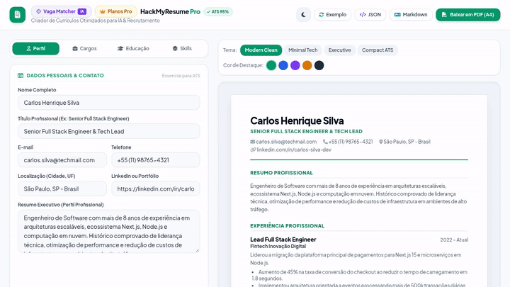

# ⚡ HackMyResume Pro v2.0

[](https://nextjs.org/)
[](https://www.typescriptlang.org/)
[](https://prisma.io)
[](https://stripe.com)
[](https://openai.com)
[](https://kiptecnologia.github.io/hackmyresume-pro/)
[](https://github.com/KipTecnologia)
[](https://kiptecnologia.github.io/hackmyresume-pro/)

> **English**: Turnkey **AI-Powered ATS Resume Builder & Micro-SaaS Boilerplate**. Built with **Next.js 15 App Router**, **TypeScript**, **Prisma ORM**, **Stripe Subscriptions & Webhooks**, and **OpenAI ATS Keyword Matcher**.  
> **Português**: Boilerplate comercial de **Micro-SaaS para Criação de Currículos Otimizados para ATS com IA**. Equipado com **Next.js 15**, **Prisma ORM**, **Stripe Checkout & Webhooks** e **OpenAI**. Engineered by **[Kip Tecnologia](https://github.com/KipTecnologia)**.

---

## 🌐 Live Interactive Demo (Bilingual EN / PT)

<p align="center">
  
</p>

Experience the live application with 1-click English 🇺🇸 and Portuguese 🇧🇷 switcher:  
👉 **[https://kiptecnologia.github.io/hackmyresume-pro/](https://kiptecnologia.github.io/hackmyresume-pro/)**

- **🎯 ATS Job Matcher (AI)**: Paste any job description to compute keyword compatibility and highlight missing ATS requirements.
- **✨ AI Bullet Optimizer**: Rewrites experience bullets with high-impact action verbs and quantified metrics.
- **🎨 4 Professional ATS Themes**: Instant switcher between Modern Clean, Executive Harvard, Minimalist Tech, and Compact ATS.
- **💳 Stripe Monetization Showcase**: Live checkout simulation for recurrent monthly subscriptions and lifetime licenses.
- **🌍 Bilingual UI & Sample Data**: Instant toggle between English (`Alexander Morgan`) and Portuguese (`Carlos Henrique Silva`).

---

## 🏗️ Production Micro-SaaS Architecture

HackMyResume Pro comes fully equipped with the production infrastructure required to launch a profitable software business:

```
hackmyresume-pro/
├── prisma/
│   └── schema.prisma           # User, Account, Session, Resume & AiAuditLog models
├── src/
│   ├── app/
│   │   ├── api/
│   │   │   ├── ai/
│   │   │   │   ├── optimize-bullet/route.ts  # OpenAI bullet point enhancer
│   │   │   │   └── analyze-job/route.ts      # ATS keyword gap analyzer
│   │   │   ├── stripe/
│   │   │   │   ├── checkout/route.ts         # Stripe Checkout session creator
│   │   │   │   ├── webhook/route.ts          # Automated plan upgrade webhook
│   │   │   │   └── portal/route.ts           # Customer billing management
│   │   │   └── auth/[...nextauth]/route.ts   # NextAuth authentication handlers
│   │   ├── globals.css                       # A4 Print stylesheets & typography
│   │   ├── layout.tsx                        # Metadata & root layout
│   │   └── page.tsx                          # Full-featured interactive studio
│   ├── lib/
│   │   ├── ai.ts                             # OpenAI integration with offline fallback
│   │   ├── auth.ts                           # NextAuth options & session callbacks
│   │   ├── db.ts                             # Prisma client singleton
│   │   └── stripe.ts                         # Stripe SDK client & pricing tiers
│   └── types/
│       └── resume.ts                         # TypeScript schemas for JSON Resume
├── .env.example                              # Documented environment variables
├── package.json
└── README.md
```

---

## 💰 Built-in Monetization & Business Model

HackMyResume Pro is pre-configured with a dual revenue model:

| Plan | Price (Global) | Price (Brazil) | Features |
| :--- | :---: | :---: | :--- |
| **Free Tier** | $0 | R$ 0 | 1 active resume, Modern Clean theme, 3 AI optimizations |
| **Pro Monthly** | $19 / mo | R$ 19 / mês | Unlimited resumes, all 4 ATS themes, 100 AI credits/mo, unwatermarked PDF |
| **Lifetime Pro** | $79 once | R$ 79 único | Lifetime access, 500 AI credits, future themes included, priority support |

---

## 🚀 Quick Start Guide (English)

### 1. Clone & Install
```bash
git clone https://github.com/KipTecnologia/hackmyresume-pro.git
cd hackmyresume-pro
npm install
```

### 2. Configure Environment Variables
Copy `.env.example`:
```bash
cp .env.example .env
```
Fill in your keys:
- `DATABASE_URL`: Defaults to local SQLite (`file:./dev.db`) for zero-config startup.
- `NEXTAUTH_SECRET`: Generate with `openssl rand -base64 32`.
- `STRIPE_SECRET_KEY` & `STRIPE_WEBHOOK_SECRET`: From your Stripe Dashboard.
- `OPENAI_API_KEY`: For live AI optimizations (system includes offline fallback if absent).

### 3. Initialize Database & Run
```bash
npx prisma db push
npm run dev
```
Open [http://localhost:3000](http://localhost:3000) to view the application.

---

## 🇧🇷 Guia de Início Rápido (Português)

### 1. Clonar e Instalar
```bash
git clone https://github.com/KipTecnologia/hackmyresume-pro.git
cd hackmyresume-pro
npm install
```

### 2. Configurar Variáveis de Ambiente
```bash
cp .env.example .env
```
O banco de dados SQLite local (`dev.db`) já vem pré-configurado sem necessidade de instalar Docker ou serviços externos. Basta rodar:
```bash
npx prisma db push
npm run dev
```

### 3. Deploy em Produção na Vercel
1. Importe o repositório na [Vercel](https://vercel.com).
2. Adicione as variáveis de ambiente do `.env.example`.
3. Configure o webhook da Stripe apontando para `https://seu-dominio.com/api/stripe/webhook` com o evento `checkout.session.completed`.

---

## 🏢 About Kip Tecnologia

**HackMyResume Pro** is engineered and maintained by **Kip Tecnologia**.

- **Website**: [kiptecnologia.com.br](https://kiptecnologia.com.br)
- **GitHub**: [github.com/KipTecnologia](https://github.com/KipTecnologia)
- **Support**: `contato@kiptecnologia.com.br`

---

## 💎 Commercial Licensing vs. Public Demo

| Feature / Asset | Public Interactive Demo (Free) | Commercial License & Full Boilerplate (Paid) |
| :--- | :---: | :---: |
| **Interactive Web Studio** | ✅ Free Access | ✅ Included |
| **Bilingual Switcher (EN / PT)** | ✅ Included | ✅ Included |
| **Client-Side PDF & Theme Generation** | ✅ Included | ✅ Included |
| **Next.js 15 App Router Full Source** | ❌ (Commercial) | ✅ **100% Unlocked** |
| **Prisma ORM & SQLite/PostgreSQL Database** | ❌ (Commercial) | ✅ **Production Models** |
| **Stripe Checkout & Automated Webhooks** | ❌ (Commercial) | ✅ **Turnkey Setup** |
| **OpenAI ATS Keyword Gap & Optimizer Endpoints** | ❌ (Commercial) | ✅ **Production APIs** |
| **100% White-Label Rights (Launch your own SaaS)** | ❌ (Evaluation only) | ✅ **Full Commercial Rights** |
| **Lifetime Updates & Discord VIP Access** | ❌ (Evaluation only) | ✅ **Included** |

👉 **[Acquire Commercial License & Full Boilerplate on Gumroad](https://rancharia.gumroad.com)**

---

## 📄 License

This repository is governed by the **Kip Tecnologia Commercial & Evaluation License (v2.0)**. The interactive demo and public assets are available for evaluation purposes. Commercial reproduction, distribution, and SaaS operation require a valid Commercial License from Kip Tecnologia. Copyright (c) 2026 Kip Tecnologia.
